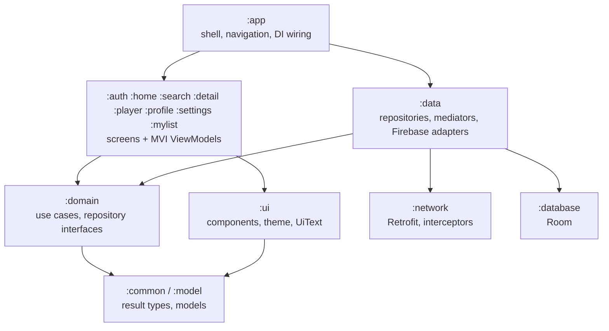

# StreamFlix

[](https://github.com/Maximum21/StreamFlix/actions/workflows/ci.yml)

A movie discovery app for Android: browse trending and curated rows, search, watch official
trailers, and keep a personal list per profile. Built with Jetpack Compose, a multi-module Clean
Architecture, Room, Paging 3, Hilt and Firebase. Film data comes from the TMDB public API.

## Features

- **Home:** hero banner, continue watching, My List and a paged row per category, with skeleton
  loading, pull-to-refresh and an offline banner.
- **Offline first:** Room is the single source of truth; list screens never read the network directly.
- **Detail:** cast, director, similar titles, share, My List toggle and an official YouTube trailer.
- **Search:** debounced paged results, recent searches and a genre filter.
- **Accounts and profiles:** email sign-in with verification, up to five profiles per account,
  server-enforced limits, in-app account deletion.
- **Settings:** theme (system, light, dark), analytics consent, new-release notifications, language, cache clearing.
- **Adaptive and localised:** bottom bar on phones, rail on tablets, English and Spanish.

## Architecture



Dependencies point towards the core and feature modules never depend on each other; the
`checkModuleGraph` task fails the build otherwise ([ADR-001](docs/adr/001-module-structure.md)).

Key decisions are recorded in [`docs/adr`](docs/adr):
[module structure](docs/adr/001-module-structure.md),
[Room as source of truth](docs/adr/002-room-as-single-source-of-truth.md),
[trailers-only player](docs/adr/003-trailers-only-player.md),
[certificate pinning](docs/adr/004-certificate-pinning.md),
[account deletion](docs/adr/005-account-deletion-and-library-data.md),
[consent-gated analytics](docs/adr/006-consent-gated-analytics-and-flags.md).

## Setup

1. **TMDB token.** Create a free account at [themoviedb.org](https://www.themoviedb.org/settings/api),
   copy your *API Read Access Token*, then:
   ```bash
   cp secrets.properties.example secrets.properties
   # edit secrets.properties and set TMDB_ACCESS_TOKEN
   ```
2. **Firebase.** Create a Firebase project, register the Android app `com.asadraza.streamflix`,
   enable Authentication (email/password) and Firestore, download `google-services.json` into `app/`
   and deploy the rules in `firebase/firestore.rules`. Neither secret file is committed.
3. **Build.** Use JDK 17 and run `./gradlew assembleDebug`.

## Quality

```bash
./gradlew --continue compileDebugKotlin testDebugUnitTest checkModuleGraph detekt ktlintCheck lintDebug \
  koverVerify :domain:koverVerify :data:koverVerify
(cd firebase && npm ci && npm test)   # Firestore rules against the emulator
```

Coverage gate: 60% of lines overall and 80% for `:domain` and `:data`, with generated code,
composables, DTOs and thin SDK adapters excluded. CI also scans for committed secrets.

## Documentation

- [`docs/SECURITY.md`](docs/SECURITY.md): threat model summary and reporting
- [`docs/ANALYTICS.md`](docs/ANALYTICS.md): events, consent and remote flags
- [`docs/PLAY_STORE.md`](docs/PLAY_STORE.md): release checklist and Data Safety answers
- [`docs/AUDIT.md`](docs/AUDIT.md), [`docs/PLAN.md`](docs/PLAN.md), [`docs/PROGRESS.md`](docs/PROGRESS.md):
  the production-readiness audit, plan and status
- [`CONTRIBUTING.md`](CONTRIBUTING.md) and [`CHANGELOG.md`](CHANGELOG.md)

## Attribution

This product uses the TMDB API but is not endorsed or certified by TMDB. Trailers are played
through the YouTube embedded player.

## License

[MIT](LICENSE)
