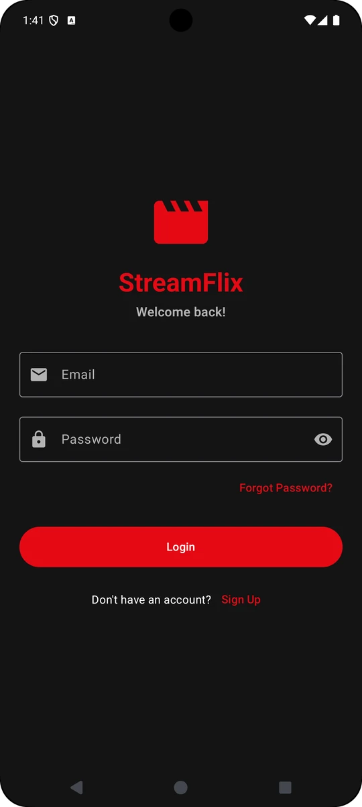
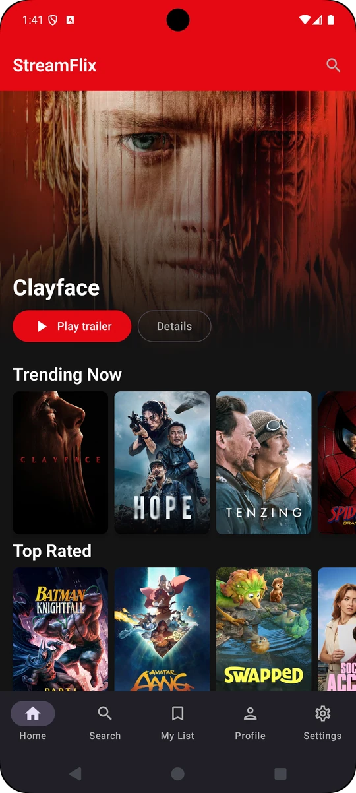
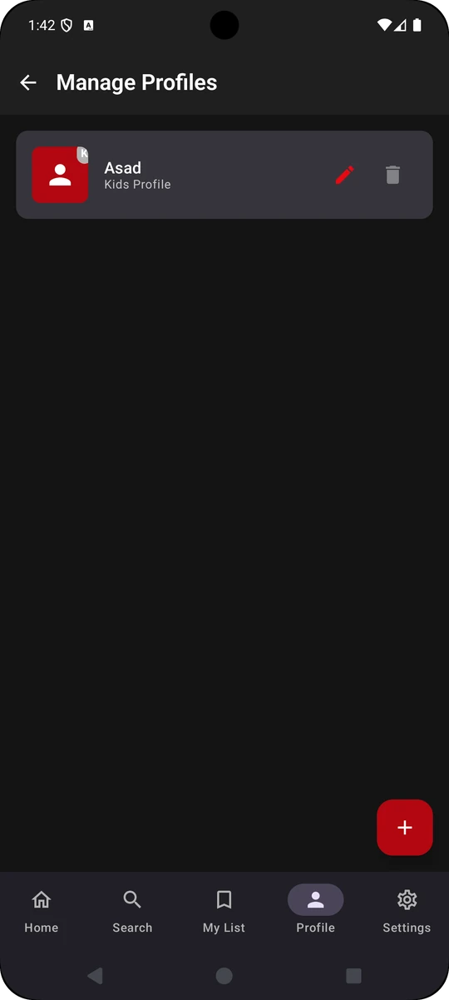
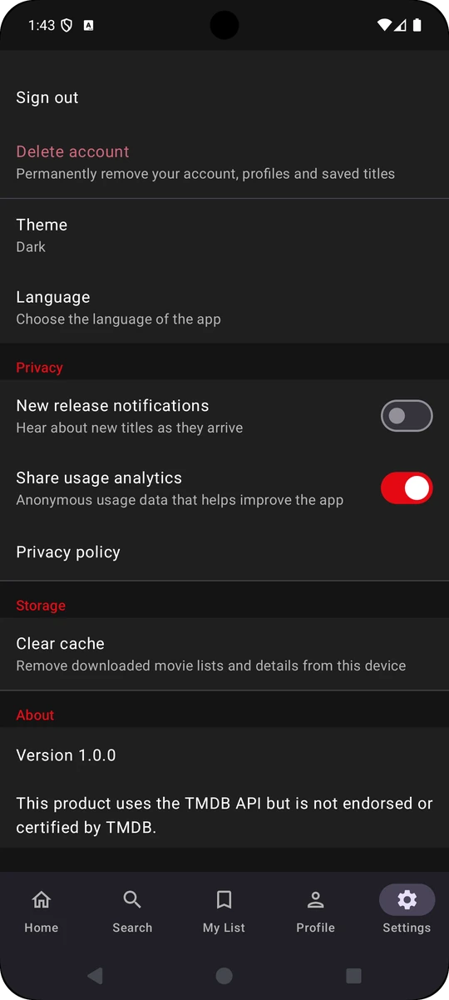
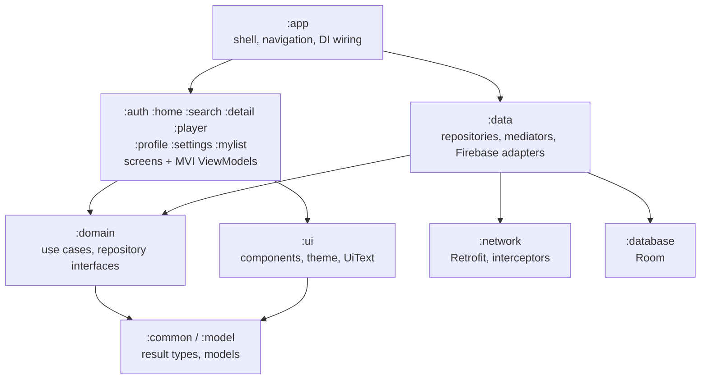
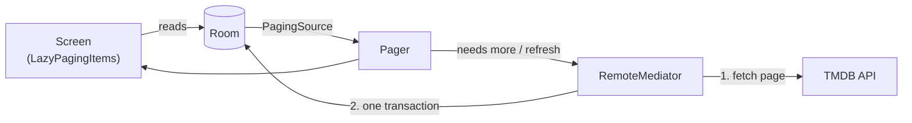

<div align="center">


# StreamFlix

**A movie discovery app for Android.** Browse what's trending, search and browse by genre, watch official trailers, and keep a personal list for each profile.

[](https://github.com/Maximum21/StreamFlix/actions/workflows/ci.yml)


[](LICENSE)

</div>

Film data comes from [The Movie Database (TMDB)](https://www.themoviedb.org/). Accounts, profiles, "My List" and watch history live in Firebase. The app is built as a multi-module Clean Architecture project, offline first, and is meant as a reference for how a production Android app can be structured, tested and shipped.

## Screenshots

<table>
  <tr>
    <td align="center"><br /><sub><b>Sign in</b></sub></td>
    <td align="center"><br /><sub><b>Home</b></sub></td>
    <td align="center"><br /><sub><b>Profiles</b></sub></td>
    <td align="center"><br /><sub><b>Settings</b></sub></td>
  </tr>
</table>

<sub>Posters and artwork come from TMDB.</sub>

## Features

**Discover**
- Home with a hero banner, *Continue watching*, *My List* and a paged row for each category, with skeleton loading, pull-to-refresh and an offline banner.
- Search with debounced, paged results and persisted recent searches, or browse by genre on the server.
- Detail pages with cast, director, similar titles, ratings, sharing and a one-tap *My List* toggle.
- Official YouTube trailers, with resume from where you stopped and a *Watch on YouTube* fallback when a video can't be embedded.

**Accounts and profiles**
- Email sign-up with verification, sign-in, password reset, and a session-aware start (the app opens on the right screen for the signed-in state).
- Up to five profiles per account, each with its own *My List* and watch history, plus a kids-profile flag.
- Account deletion inside the app: it re-authenticates, erases your data, then the account.

**Settings and polish**
- Light, dark or system theme, English and Spanish, and Android 13+ per-app language.
- Opt-in analytics (a consent prompt, off until you agree) and opt-in new-release notifications.
- Adaptive layouts: a bottom bar on phones, a navigation rail on wider windows, and adaptive poster grids.
- A Remote Config feature flag, a `streamflix://movie/{id}` deep link, and a themed (monochrome) launcher icon.

## Architecture



Dependencies point towards the core, and feature modules never depend on each other or on `:data`. The `checkModuleGraph` task fails the build if that rule is broken ([ADR-001](docs/adr/001-module-structure.md)).

### Offline first

Room is the single source of truth. List screens read only from the database through Paging 3, and a `RemoteMediator` is the only writer: it fetches a page first, then stores it in one transaction, so a failed refresh keeps what is already on screen ([ADR-002](docs/adr/002-room-as-single-source-of-truth.md)).



### Screens follow MVI

Each screen has a contract (state, events, one-off effects), a ViewModel that exposes `StateFlow` state and an effect `Flow`, and a Composable that only renders state and forwards events. ViewModels depend on use cases, never on Firebase, Room or Retrofit. Errors travel as reasons and codes (`ErrorType`), and the UI turns them into localised text, so no ViewModel builds a user-facing string from an exception.

### Modules

| Module | Responsibility |
| --- | --- |
| `:app` | Application, navigation, app shell, consent prompt, messaging service |
| `:auth` `:home` `:search` `:detail` `:player` `:profile` `:settings` `:mylist` | One feature each: screens, ViewModels, contracts |
| `:domain` | Use cases and repository interfaces |
| `:data` | Repository implementations, RemoteMediators, Firebase and DataStore adapters |
| `:network` | Retrofit service, interceptors (auth, retry with backoff), safe API calls |
| `:database` | Room entities, DAOs, schema |
| `:ui` | Shared components, theme, `UiText` |
| `:common` `:model` | Result and error types, constants, models |
| `:testing` | Shared test fixtures and the main-dispatcher rule |
| `:baselineprofile` | Baseline profile generator |

## Tech stack

| Area | Choice |
| --- | --- |
| Language and UI | Kotlin 2.0.21, Jetpack Compose (BOM 2025.11), Material 3, Navigation (type-safe routes) |
| Architecture | Multi-module Clean Architecture, MVI, Hilt, convention plugins in `build-logic` |
| Data | Room 2.7, Paging 3 with RemoteMediator, Retrofit 2.11, OkHttp 4.12, kotlinx.serialization, DataStore |
| Images and video | Coil 3, android-youtube-player |
| Firebase | Authentication, Firestore, Crashlytics, Performance, Analytics, Remote Config, Cloud Messaging, App Check |
| Concurrency | Coroutines 1.10 and Flow |
| Quality | JUnit, MockK, Turbine, Robolectric, Compose UI tests, MockWebServer, Kover, detekt, ktlint, Android Lint, LeakCanary (debug) |

## Quality

- **285 unit tests** across the modules, including Compose screen tests under Robolectric, RemoteMediator tests against an in-memory Room database, and MockWebServer tests for the network layer.
- **35 Firestore security-rules tests** run against the Firebase emulator.
- **Coverage gate** enforced by Kover: at least 60% of lines overall and 80% for `:domain` and `:data` (generated code, composables, DTOs and thin SDK adapters are excluded).
- **Static analysis** on every build: detekt and ktlint with zero tolerated issues, Android Lint, and the module-graph check.
- **A Hilt graph smoke test** builds the real dependency graph with only the Firebase instances replaced.

## Security and privacy

- HTTPS only, with certificate pinning for the TMDB API and cleartext traffic disabled ([ADR-004](docs/adr/004-certificate-pinning.md)).
- Firestore rules are owner-only, validate every document shape and are covered by tests; App Check uses Play Integrity in release builds.
- Backups are disabled, release builds are minified with R8, and credential screens block screenshots.
- Analytics is off until the user agrees and never records what was searched for ([docs/ANALYTICS.md](docs/ANALYTICS.md)).
- Secrets never live in the repository, and CI scans the full history for them on every run. See [docs/SECURITY.md](docs/SECURITY.md).

## Getting started

### Prerequisites

- JDK 17 and a recent Android Studio
- A free [TMDB](https://www.themoviedb.org/settings/api) account for the read access token
- A Firebase project of your own
- Node.js 22 and Java 21, only if you want to run the Firestore rules tests

### 1. TMDB token

```bash
cp secrets.properties.example secrets.properties
# edit secrets.properties and set TMDB_ACCESS_TOKEN
```

The file is git-ignored. CI reads the same value from a `TMDB_ACCESS_TOKEN` secret.

### 2. Firebase

1. Create a project, register the Android app `com.asadraza.streamflix`, and download `google-services.json` into `app/` (also git-ignored).
2. Enable **Authentication → Email/Password** and create a **Firestore** database.
3. Deploy the security rules:
   ```bash
   cd firebase && npm ci
   npx firebase deploy --only firestore:rules --project <your-project-id>
   ```
4. Optional: enable Remote Config (key `show_hero_banner`), Cloud Messaging and Crashlytics. Debug builds use the App Check debug provider; register the debug token it prints in Logcat if you turn App Check enforcement on.

### 3. Build and run

```bash
./gradlew assembleDebug        # or run the app from Android Studio
```

### Run the checks

```bash
./gradlew --continue compileDebugKotlin testDebugUnitTest checkModuleGraph detekt ktlintCheck lintDebug \
  koverVerify :domain:koverVerify :data:koverVerify
(cd firebase && npm test)      # Firestore rules against the emulator
```

## Continuous integration and releases

- **CI** (`.github/workflows/ci.yml`) runs on pull requests and on pushes to `main`: static analysis, unit tests with the coverage gate, a debug build, a full-history secret scan, and the Firestore rules tests.
- **Release** (`.github/workflows/release.yml`) starts only when a pull request from a `release/X.Y.Z` branch, whose latest commit message is `release: X.Y.Z`, is merged into `main`. One job builds a signed bundle; a second job publishes it. A mismatch between the branch name and the commit message fails before anything is built.

### Releasing your own build

Releases need credentials that this repository does not contain. To publish a copy of your own, add these repository secrets and create a `release` environment (Settings → Environments), where you can require a reviewer to approve every release:

| Secret | Used for |
| --- | --- |
| `TMDB_ACCESS_TOKEN`, `GOOGLE_SERVICES_JSON` (base64) | Building the app |
| `SIGNING_KEYSTORE_BASE64`, `SIGNING_STORE_PASSWORD`, `SIGNING_KEY_ALIAS`, `SIGNING_KEY_PASSWORD` | Signing the bundle with your own keystore |
| `FIREBASE_APP_ID`, `FIREBASE_SERVICE_ACCOUNT` (optional) | Firebase App Distribution |
| `PLAY_SERVICE_ACCOUNT_JSON` (optional) | Uploading to the Google Play internal track |

Without the signing secrets the build is unsigned, and without the optional ones nothing is published. Google Play requires the first bundle of a new app to be uploaded manually in the Play Console. Before listing an app you will also want your own name and icon, and a privacy policy hosted at a URL you control (the one in `docs/privacy.html` describes this app).

## Project layout

```
StreamFlix/
├── app/                  application shell and navigation
├── auth/ home/ search/ detail/ player/ profile/ settings/ mylist/   feature modules
├── domain/ data/ network/ database/ ui/ common/ model/              core modules
├── testing/              shared test support
├── baselineprofile/      baseline profile generator
├── build-logic/          convention plugins
├── firebase/             Firestore rules and their emulator tests
├── config/detekt/        static analysis configuration
└── docs/                 architecture decisions, security, analytics, store checklist
```

## Documentation

- [Architecture decision records](docs/adr): [module structure](docs/adr/001-module-structure.md), [Room as source of truth](docs/adr/002-room-as-single-source-of-truth.md), [trailers-only player](docs/adr/003-trailers-only-player.md), [certificate pinning](docs/adr/004-certificate-pinning.md), [account deletion](docs/adr/005-account-deletion-and-library-data.md), [consent-gated analytics](docs/adr/006-consent-gated-analytics-and-flags.md), [use cases and Paging in the domain](docs/adr/007-use-cases-and-paging-in-the-domain.md)
- [Security](docs/SECURITY.md) · [Analytics, flags and notifications](docs/ANALYTICS.md) · [Privacy policy](https://maximum21.github.io/StreamFlix/privacy.html)
- [Contributing](CONTRIBUTING.md) · [Changelog](CHANGELOG.md)

## Known limitations

- Playback is limited to official YouTube trailers: TMDB provides metadata, not streams ([ADR-003](docs/adr/003-trailers-only-player.md)).
- Text search and genre browsing are separate modes, because TMDB's search endpoint cannot filter by genre.
- The deep link uses a custom scheme, not verified App Links.
- The baseline profile has to be generated on a device (`./gradlew :app:generateBaselineProfile`).

## Contributing

Issues and pull requests are welcome. Please read [CONTRIBUTING.md](CONTRIBUTING.md) first: it lists the checks a change must pass and the conventions the project follows.

## Attribution

This product uses the TMDB API but is not endorsed or certified by TMDB. Trailers are played through the YouTube embedded player.

## License

[MIT](LICENSE)
